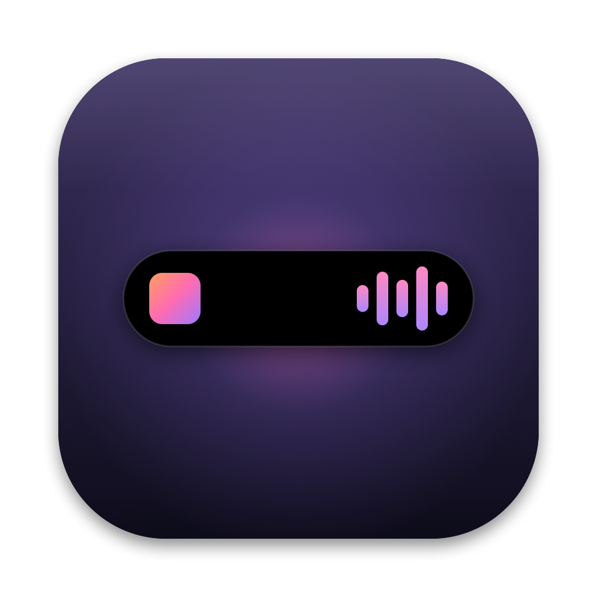
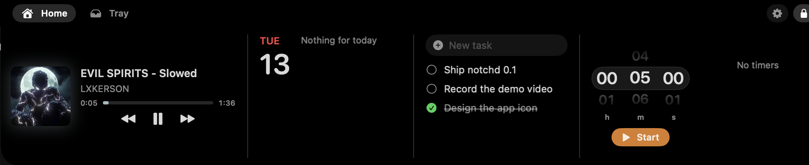
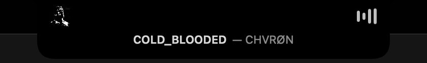
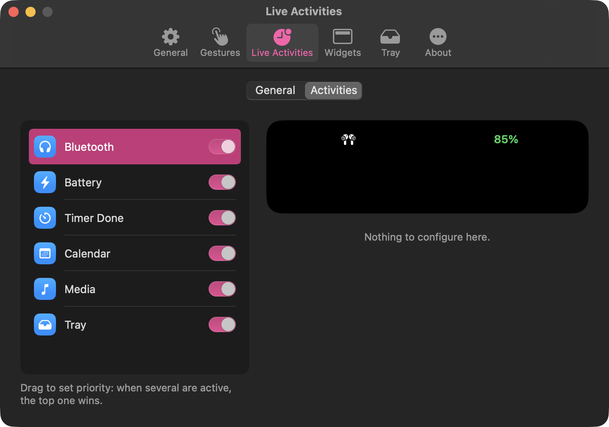
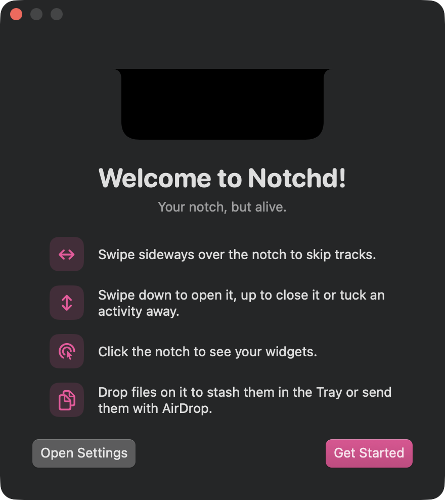

<p align="center">
  
</p>

<h1 align="center">notchd</h1>

<p align="center">
  <b>Your MacBook notch, but alive.</b><br>
  A clean, open-source, Dynamic Island–style notch for macOS: music, calendar, timers, a file tray and live activities, all with springy Apple-like animations.
</p>

<p align="center">
  
  
  
  
</p>

<p align="center">
  
</p>

---

## Why

The notch is dead space. notchd turns it into a small, living surface: it grows when something happens (a song plays, a meeting is about to start, your AirPods connect) and opens into a panel of widgets when you click it.

No account, no subscription, no telemetry. Everything stays on your Mac, and the code is right here.

## Features

### Live activities
The closed notch widens to show what's going on, then tucks itself away.

<p align="center">
  
</p>

| Activity | What it shows |
|---|---|
| 🎵 **Media** | Cover art and an animation (equalizer, wave, pulse or your own GIF), tinted with the cover's color. Works with Spotify, Apple Music, browsers and any app that reports Now Playing. |
| 📅 **Calendar** | Countdown to your next event; a green button joins Google Meet, Zoom, Teams or Webex calls in one click. |
| 🎧 **Bluetooth** | Device connected / disconnected, with battery level for AirPods. |
| 🔋 **Battery** | Charger connected or disconnected, fully charged, running low. |
| ⏱️ **Timer Done** | A ringing timer with a Stop button. |
| 🗂️ **Tray** | How many files are waiting in your tray. |

- **Glance**: point at an activity and a line of details slides out below it (song title, event time, battery estimate…).
- **Your priorities**: drag activities to choose which one wins when several are active.
- **Swipe up** to tuck an activity away. It comes back on its own when there's news.
- **Fullscreen aware**: pick which activities may appear over fullscreen apps.

### Widgets
Click the notch (or swipe down) to open it.

- **Media player**: artwork, controls, draggable progress bar.
- **Calendar**: today's events.
- **To-do list**.
- **Timers**: scroll wheels with haptic ticks, several timers at once, saved across restarts.

Widgets are sized in units (1U = 100 pt). The notch grows to fit exactly what you enabled and never takes more than 75% of the screen. Reorder, resize or hide widgets in Settings.

### Tray & drop zone
Drag anything to the top of the screen and the notch opens into drop zones.

- **Tray**: keeps files at hand. Drag them back out to copy, or ⌥-drag to move. Paste with ⌘V (text, images and links become files).
- **AirDrop**: send files, links or text without opening Finder.
- Finder-style shortcuts: multi-select, Space for Quick Look, ⌘C, Delete, Return to rename.
- Choose where tray files live, copy or move on drop, auto-clear old files. Removed files go to the Trash, never straight to oblivion.

### Make it yours

<p align="center">
  
</p>

- Pill-shaped or rounded-square buttons, frosted glass background (experimental), inner spacing.
- Trackpad gestures: swipe down/up to open/close, sideways to skip tracks (direction reversible).
- Handle size for screens without a notch, or hide it until hovered.
- Notch size adjustment, haptics on/off, launch at login, presentation mode for recordings.

<p align="center">
  
</p>

## Install

notchd isn't notarized yet, so for now you build it yourself. It takes about a minute.

**Requirements:** macOS 14 Sonoma or later, Xcode or the Command Line Tools (`xcode-select --install`), and `cmake` for the media helper (`brew install cmake`).

```sh
git clone https://github.com/notchd-app/notchd.git
cd notchd
./scripts/bundle.sh
open build/Notchd.app
```

Move `build/Notchd.app` to `/Applications` to keep it. If you have an Apple Development certificate, `bundle.sh` signs with it so macOS remembers your permissions across rebuilds; otherwise it signs ad hoc.

### Permissions
notchd only asks for what a feature needs, the first time it needs it:

| Permission | Used for |
|---|---|
| Calendars | Calendar widget and live activity |
| Bluetooth | Device connect/disconnect activity |

Now Playing works without any permission through [mediaremote-adapter](https://github.com/ungive/mediaremote-adapter).

## Gestures cheat sheet

| Do this on the notch | To |
|---|---|
| Click / swipe down | Open |
| Swipe up / move the pointer away | Close |
| Swipe up on an activity | Tuck it away |
| Swipe left / right | Previous / next track |
| Right-click | Settings, Quit |
| Drag a file to the top of the screen | Tray or AirDrop |

## Development

```
Sources/Notchd/
  main.swift            app delegate, one notch window per screen
  NotchController.swift window, pointer tracking, gestures, keyboard
  NotchModel.swift      notch geometry and state, spring presets
  NotchView.swift       the notch shape and its states
  LiveActivities.swift  activity priority, Glance, fullscreen detection
  Media / Calendar (Widgets) / Timer / Tray / Bluetooth / Battery .swift
  Grid.swift            unit-based widget layout
  Settings.swift        preferences (one JSON blob) and the Settings window
  Welcome.swift         first-launch tour
Tests/NotchdTests/      unit tests (Swift Testing)
scripts/                bundle, tests, media helper, icon
```

```sh
./scripts/test.sh     # unit tests
./scripts/bundle.sh   # build build/Notchd.app
./scripts/make-icns.sh  # regenerate the icon from scripts/make-icon.swift
```

Handy launch arguments while hacking:

```sh
open build/Notchd.app --args --open                  # open the notch on launch
open build/Notchd.app --args --settings              # open Settings
open build/Notchd.app --args --welcome               # show the welcome tour
open build/Notchd.app --args -demo bluetooth         # battery | unplugged | full | low | bluetooth | timer | peek
open build/Notchd.app --args -debugFakeEvent YES     # fake video call in 5 minutes
```

Pull requests are welcome. Keep the animations springy and the code small.

## Roadmap

- [ ] Notes, Shortcuts, Camera mirror and app launcher widgets
- [ ] Calendar day strip, to-do favorites and archive
- [ ] Drop-zone actions (zip, convert, compress images…) with installable packs
- [ ] Volume & brightness overlay
- [ ] Signed, notarized releases with in-app updates

## Credits

- [mediaremote-adapter](https://github.com/ungive/mediaremote-adapter) by ungive (BSD-3-Clause), which makes Now Playing work on macOS 15.4 and later.

## License

[Apache 2.0](LICENSE).

notchd is an independent project, not affiliated with or endorsed by Apple Inc. "Dynamic Island" is a trademark of Apple Inc., used here only to describe the style of the interface.
